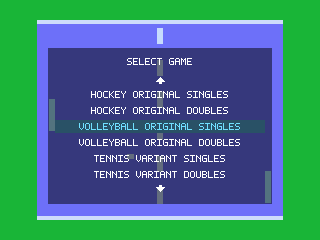
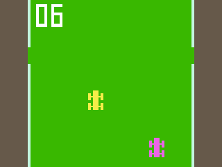
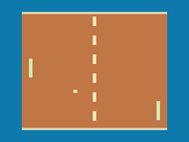
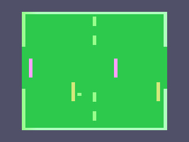
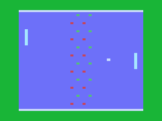
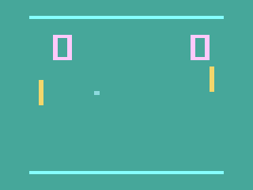

# Color TV-Game Simulator

Color TV-Game Simulator is a libretro core with a `.ctg` content loader and a launch menu showing the selected game's provisional title. The 15 provisional Color TV-Game 6/15 variants (IDs 0–14) have playable implementations. Racing 112 is a single additional console entry, ID 15, with all seven reported configuration groups and four binary switches selectable (112 combinations). One-player low/low gearing is additionally selectable beyond those reported groups; historical game numbering is not implemented. Racing is integrated into the selector and direct-content launch; the user confirmed Racing play and steering in a frontend. Physics and presentation are approximations, not verified original hardware behavior. In Racing, L2/LT selects the LOW lever position and R2/RT selects HIGH; holding a trigger does not repeat. Both held together cancel shifting, and the lever position persists after release. Steering is available during the startup countdown; both players are protected from opponent and wall crashes for the first second of active gameplay after the countdown. Opponent positions are randomly chosen, and the car automatically speeds up after startup and impacts. These mappings and speed transitions are approximations of a documented two-position gear lever, not verified original hardware behavior. Historical details and game assignments remain unverified.

The Racing launch menu saves a **SPEED** switch (Low, Medium or High; default High). In unchanged one-player modes, LOW lever always selects low speed and HIGH selects the switch setting. Two-player Racing accelerates both lanes together toward the shared switch-selected speed, and a collision in either lane slows both. It features two side-by-side tracks and independent scoring per lane. Corresponding opponents share the same randomly selected position relative to their respective lanes; vertically spaced opponents have independent positions. The road is darker green than in spacious one-player mode, and the player cars are green; colors are approximated from reference material. P2 steers using its D-pad or left stick; P1 uses the same controls on its own port. The user confirmed two-player scoring and behavior in RetroArch. The **MORE CARS** switch adds a second opponent: side-by-side on the spacious road, or half a road section apart in narrow and two-player modes. The latter spacing is provisional, pending evidence. For car-to-car collisions, each six-cell-wide car has a four-cell-wide hitbox inset by one Racing cell on each side; vertical bounds are unchanged, and touching edges alone do not count as a collision. This does not change car visuals or wall detection. The provisional **WALL CRASH** switch defaults to Off. When On, overlapping an outer or center boundary triggers the normal crash effect; the affected car automatically moves clear and is temporarily invulnerable during recovery. Following any collision, the affected player is protected from further vehicle and wall collisions during recovery, even when WALL CRASH is Off; in two-player mode each player's protection is independent while slowdown is shared. The boundary also counts as solid where its dashed line is invisible. The **CAR PATH** switch selects Straight (default) or Zigzag; zigzag traffic moves sideways, reversing at the bounds and sometimes at intermediate points; an unobstructed bound-to-bound crossing takes 1000 ms in every layout. Vertically spaced opponents follow independent paths, while corresponding two-player opponents and the spacious side-by-side pair remain synchronized. The **BAD ROAD** switch defaults Off. When On, brown dirt alternates with the normal road; both player cars wiggle between their steered position and two cells left in eight-frame phases while their center is on dirt. Traffic is unaffected, and collision and wall checks use the displayed position. Dirt lasts 5 or 6 road sections, with boundaries three vertical cells before an edge gap. The provisional generator chooses a fresh random interval of 5–12 regular sections between dirt stretches. The user confirmed the spacing, dirt border color, preview, and vibration on exiting dirt in RetroArch, as well as rumble on dirt. This range is an assumption, not a claim or guarantee about original hardware; the reported 5–6-section spacing was an example, not a rule. Dirt is sampled at the car's vertical center, wiggle starts at the steering position on entry, resets on exit, and is clipped at the lane edge. Preview carries its visible road layout into a race; road randomization uses its own generator, separate from traffic, and preview and gameplay use separate instances. Its exact distribution, brown color, contact point and wiggle phase are approximations, as are wall and path behavior.

Public labels use **Original** for former B IDs 2, 3, 6, 7, 10 and 11, and **Variant** for former A IDs 0, 1, 4, 5, 8 and 9. IDs, gameplay, selector order and suffixes are unchanged. Original is a project label, not proof of historical primacy or CTG-6 availability; the `Color TV Game 6 + 15` suffix remains an unverified hypothesis. See [content format](docs/CONTENT_FORMAT.md) for the complete mapping.

The core implementation and headless tests build and pass on Linux. A bounded RetroArch 1.22.2 smoke test loaded ID 2, initialized video and audio, ran 120 frames and unloaded successfully. In a separate launcher session, a user played ID 2 (Tennis Original Singles) in RetroArch with an Xbox controller for player 1 and keyboard arrows for player 2; the match reached 15 and displayed the win screen. Restart and play with two separate controllers were not confirmed. ID 2 uses approximate procedural sound. By design, the core does not support save states or rewind and requires frontend support for XRGB8888 video.

**Disclaimer:** Color TV-Game Simulator is an independently developed project. It is not affiliated with, endorsed by, or sponsored by Nintendo.

## Screenshots


| Game selector | Racing 112 |
| --- | --- |
|  |  |
| Choose a game from the built-in selector. | Drive on the wide road. |

| Tennis | Hockey |
| --- | --- |
|  |  |
| Tennis playfield. | Hockey doubles playfield. |

| Volleyball | Shooting Game |
| --- | --- |
|  |  |
| Volleyball playfield. | Shooting Game playfield. |

## License

The project is licensed under the [MIT License](LICENSE). The vendored Libretro API header has its own copyright and MIT license notice in `third_party/libretro/libretro.h`; retain that notice when distributing it or applicable portions of the software.

## Relationship to the reference simulator

This project was originally conceived as a port of [Thomas Visvader's Python simulator](https://github.com/ThomasVisvader/Pong/tree/e654c5ff909851dac9360000c2c269562cf0c735/Nintendo%20Color%20TV-Game%2015). Because no applicable license was identified for that repository, and to support planned improvements and additional features, it evolved into an independently developed implementation written from scratch. Thomas's simulator, including its Python source code, was examined as a behavioral reference, not used as a source-code dependency: none of its Python source code has been copied, translated, ported, or incorporated into this core.

Racing 112 follows the same research-driven approach, using original-hardware footage, electronic schematics, and historical documentation to inform an independent implementation. The unresolved reuse permissions concern the external Python repository, not this core's MIT license. See [Research](docs/RESEARCH.md#reference-repository-and-licensing) for the sources and licensing findings.

## Game selection at startup

The **Selected game at start** core option controls the initial highlight when starting without content: **Last used** (default), **First**, or **Random**. Last used remembers the last game highlighted while navigating the selector, without requiring confirmation; games opened directly as `.ctg` files do not change it. The core stores that selection in `colortvgame-last-game` under the frontend's save directory, so it can survive a full restart if the directory is available and writable. If it cannot be read, the selector starts on the first game; if saving fails, the core reports a message. Direct `.ctg` launches always open their specified game.

The **Lock direct-launched game** core option is Off by default. When On for a direct `.ctg` launch, the launch menu hides Return and Back does nothing; pause and result Exit return to the launch menu. Close the content or turn the option Off to choose another game. No-content sessions are unaffected. The user confirmed direct-launch locking in RetroArch; the hidden Return layout is a subsequent change.


## Analog controls

In rally games, both players' left-stick vertical deflection controls paddle speed; in Shooting it controls P1 aim and the P2 manual target. The inclusive 8192 deadzone stops movement, and speed rises proportionally to full digital speed at maximum deflection. Fractional movement accumulates for smooth slow control. An active stick takes precedence over RetroPad directions (including frontend analog-to-digital mappings); center it to use the D-pad at full speed. Shooting's direct W/S keys override the stick. Paddle and shooter bounds still apply; the manual target wraps as before. AI, demos, automatic targets and menu navigation are unchanged. See [controls](docs/LIBRETRO_CORE.md#controls) for the full mapping.

## Rally serves

Rally games serve automatically after approximately 2.17 seconds. The first serve starts on the left; after a point, the player who scored serves from their paddle's current center. The ball retains the previous vertical velocity and horizontal speed, traveling away from the server. The first serve has no previous angle and uses a provisional generated angle.

## Rebound behavior

The **Rebound behavior** core option selects an approximate paddle rebound model for competitive games and their demos. **Hit position** is the default and retains the existing behavior; **Paddle movement** instead uses each player's last actual paddle movement, even after stopping, to select the vertical rebound direction; contact position selects its magnitude. Before a paddle has moved, it falls back to hit-position behavior. Movement history resets when the match is reset. Changes apply during play and previews. The original hardware's behavior is uncertain, so neither model should be considered verified; the movement-based model can also produce long, nearly horizontal rallies.

## Vibration

The **Vibration** core option defaults to **Off**. When enabled, a supported controller briefly vibrates when its player's paddle hits the ball or when the player fires in Shooting, collides in Racing, or moves in a BAD ROAD wiggle. Automatic serves do not trigger vibration. AI-controlled players and menu demos do not trigger vibration. This is a modern convenience, not a feature of the original controllers; it requires frontend and controller rumble support. The user confirmed vibration works with a controller in RetroArch; the Off default has not been separately confirmed there.

## Shooting fire sound

The **Shooting fire sound** core option defaults to **On**, playing the wall-collision sound when firing in gameplay and previews. Set it to **Off** for silent firing, as observed on the original console. This does not affect the target-hit or shot-exit sounds, or vibration.

## Original features mode

The frontend's **Original features mode** core option defaults to Off. When On, rally games use two human players and a 15-point score, with ice hockey disabled; Shooting uses 15 shots, manual or normal target movement, downward automatic motion, large/small targets and low/high shot speed. The selected Shooting size applies to both shooter and target, independently of shot speed. Stereo, vibration and Shooting fire sound are forced off. Anti-stalemate and all Racing modes and switches remain available. Excluded in-game menu rows are hidden. The overridden frontend core options remain visible; changes made while the mode is on take effect when it is turned off.

Saved game-menu choices are retained and restored when the mode is turned off; choices still available in the mode update their shared preferences when changed. Unsupported saved Shooting values use safe effective defaults without changing those preferences. Toggling the mode during a rally or Shooting match restarts the match; Racing continues. The frontend saves the mode option and a writable save directory is needed for game-menu preferences. This simulator setting is not a historical fidelity claim. See `GAME_MANUAL.md` for details.

## Anti-stalemate

The **Anti-stalemate** core option is **On** by default. On the third consecutive horizontal paddle rebound, it adds a small vertical angle at the hit to help break a stalemate; there is no timer. It applies to competitive games and their demos, and changes take effect during play and previews. Set it to **Off** to disable the intervention. This is a modern approximation, not proven behavior of the original hardware.

## Display

The **Color** core option is On by default. Set it to **Off** for a grayscale picture resembling a black-and-white TV. It applies to the entire core image, including game menus and demos; RetroArch's own interface is unaffected. Changes take effect when the core resumes. The optional **RF filter** is Off by default. When enabled, it applies a provisional NTSC-like color and bandwidth effect to the core image before grayscale conversion. **RF signal quality** ranges from 100% (default) to 0% in 10% steps; lower values add color bleed and moving noise. It has no effect while the RF filter is Off. This is a visual approximation, not a verified model of the console's RF signal.

## Attract/demo mode

The game selector and each game's launch menu show an animated, scoreless preview of the selected game. Competitive previews alternate both players between Hard and Easy AI every three seconds, starting with Hard; Shooting uses its own automated preview. After 10 seconds without input, the menu disappears, a demo prompt appears at the top, and the game title and variant appear at the bottom. Input restores the same menu without navigating, changing a setting, or starting a game; a subsequent input can be used normally. Previews follow applicable game options: rally ball speed and paddle sizes; Shooting target movement, direction and size, and shot speed; and Racing road mode, MORE CARS, CAR PATH and BAD ROAD settings. Shooting's manual target is moved automatically in the preview, and random choices use a separate demo RNG. Score and shot limits and the selected opponent mode do not govern previews. Preview activity does not change settings or real-game scores. Racing carries the preview road and traffic layout into a race at start or result restart; the player starts centered in the selected lane. The **Demo sounds** core option is On by default and can be switched Off; changes take effect when the core resumes. Preview sounds are independent of gameplay audio. **Demo game rotation** defaults to **Random every 15 seconds**, choosing a different game every 15 seconds while the selector menu is hidden. Choose **Every 15 seconds** for sequential rotation or **Off** to disable it. A previously saved setting may override the new default. Input stops the rotation and restores the menu on the displayed game; the menu hides again after 10 seconds of inactivity, and rotation resumes 15 seconds later. Automatic rotation does not change the saved last selection, and individual game launch menus do not rotate. The user confirmed demo rotation, the hidden-screen title, wake behavior and last-selection preservation in RetroArch.

At fast ball speeds, demo AI can struggle to keep up; previews are not a measure of gameplay AI performance.

Version 0.2.1 reads game-menu preference formats 1–9 and writes extensible version 9. Version 0.1.9 reads version 9, ignores the unknown BAD ROAD setting and preserves it when saving. Version 0.1.8 and earlier cannot read version 9; 0.1.8 ignores it and retains current or default settings, and a later menu change may overwrite it; back up `colortvgame-preferences` in the frontend save directory before upgrading if you may downgrade, and restore the backup when returning to an older core. Changes made after the backup will not be retained.

## Build and test

Install CMake 3.16 or newer and a C++17 compiler, then from the repository root run:

```sh
cmake -S . -B build
cmake --build build
ctest --test-dir build --output-on-failure
```

On Linux the shared core is `build/colortvgame_libretro.so`; the extension and output location can differ by platform or build configuration. For multi-configuration generators such as Visual Studio, use `cmake --build build --config Release` and `ctest --test-dir build -C Release --output-on-failure`. Tests use a simulated frontend, not RetroArch.

### Source layout

- `src/core.cpp`: Libretro lifecycle, frontend options and callbacks, session/menu transitions, and frame coordination.
- `src/graphics.*`: framebuffer drawing, bitmap font, score glyphs, grayscale and RF filtering.
- `src/renderer.*`: game views, menus and diagnostic overlays, using read-only game/session state.
- `src/audio.*`: gameplay/demo tones and Racing countdown, engine, collision and bonus effects.
- `src/controls.*`: controller/keyboard mapping, analog handling, input descriptors and menu-repeat timing.
- `src/tennis_b.*`, `src/shooting.*`, `src/racing.*`, `src/opponent.*`: game simulation and AI; `src/demo.*` drives the independent previews. `src/game_catalog.h` shares game IDs, titles and rally-variant construction.
- `src/core_options.h`, `src/preferences.*`: option registration and persistent-file handling.

The `core_tests` integration runner uses `tests/core_test_harness.*` and focused `tests/core_*_scenarios.cpp` files. Its scenarios retain their order because some deliberately exercise state across lifecycle transitions. The `tennis_b_tests` runner groups mechanics and variants in `tests/tennis_*_tests.cpp`, sharing comparison helpers through `tests/tennis_test_harness.h`. CTest still runs each of these runners as one test; splitting the source files does not remove scenarios.

## GitHub Actions builds

The [build workflow](.github/workflows/build.yml) is configured to build Release and run the applicable CTest suite on GitHub-hosted Linux x86-64, experimental Linux ARM64, Windows x86-64 and macOS x86-64 runners. The Linux ARM64 job checks the ELF architecture; the macOS job requests x86-64 and checks the built Mach-O architecture with `lipo`. ARM64 CI does not establish Raspberry Pi, Recalbox or RetroPie compatibility. Successful jobs upload separately named artifacts containing the core, both license notices, [game manual](GAME_MANUAL.md) and [usage instructions](docs/CI_ARTIFACT.md). The Linux-only package test and Unix launcher test run only on their applicable platforms.

[GitHub Actions run 43233049758](https://github.com/d-cglt/color-tv-game-simulator/actions/runs/43233049758) built and tested the 0.1.3 tag on all three runners, including a macOS x86-64 architecture check. Releases should include Linux x86-64, Windows x86-64 and macOS Intel builds when available; report any unavailable platform rather than silently omitting it. Windows and macOS release archives contain CI-built artifacts and have not been validated in a real frontend. They remain experimental: frontend compatibility, runtime requirements and distribution readiness are unverified. Apple Silicon is not built; matching architecture alone does not guarantee that a frontend can load the core.

## Linux release package

See the [0.2.1 release notes](docs/RELEASE_NOTES_0.2.1.md) for changes and validation limits. The current CMake project version is 0.2.1; a version number alone does not establish release or frontend validation. Build and test a Release configuration, then assemble the versioned package from that exact core:

```sh
cmake -S . -B build-release -DCMAKE_BUILD_TYPE=Release
cmake --build build-release
ctest --test-dir build-release --output-on-failure
sh scripts/package-linux.sh build-release/colortvgame_libretro.so build-release/colortvgame-0.2.1-linux.tar.gz
```

The archive contains the Color TV-Game Simulator core, project license, vendored libretro header's MIT notice, [game manual](GAME_MANUAL.md), and [end-user instructions](docs/LINUX_RELEASE.md). The script packages the supplied binary as-is; build it on an appropriate Linux target and verify runtime compatibility for distribution. The CMake project version controls the version reported by the core; choose an archive name matching the built binary, since the script does not verify its version or revision. It does not guarantee byte-identical archives or bundle RetroArch, metadata, launchers, or content. CTest assembles and extracts a package, checks its payload and notices, and dynamically loads the packaged core; this is not a substitute for frontend validation.

## Linux launch commands

Build the core as above. To open the game selector without a content file, run `./scripts/no-content.sh`. Alternatively, invoke a named game through the launcher:

```sh
./scripts/launch.sh tennis-original-singles
./scripts/launch.sh volleyball-variant-doubles
```

Use `tennis`, `hockey`, or `volleyball`, followed by `original` or `variant`, and `singles` or `doubles`. Other names are `ping-pong-singles`, `ping-pong-doubles`, and `shooting-game-original`. Existing A/B names and individual scripts remain supported: A selects Variant and B selects Original (for example, `./scripts/tennis-b-singles.sh` selects ID 2). All selectors open playable implementations; fidelity and interactive validation remain in progress. The launcher prefers `retroarch` on `PATH`, otherwise it tries the RetroDECK Flatpak (`net.retrodeck.retrodeck`). Set `CTG_FRONTEND=native` or `CTG_FRONTEND=retrodeck` to force a choice. RetroDECK runs its bundled `retroarch` with temporary read-only filesystem access to the project; no persistent Flatpak permissions or frontend configuration are changed. Flatpak must be installed and RetroDECK must include its RetroArch executable at `/app/retrodeck/components/retroarch/bin/retroarch`. If the sandbox or installation cannot load the core, use native RetroArch instead. Paths with spaces and quotes are supported; Flatpak filesystem syntax does not support a colon in the project or temporary path. The launcher expects `build/colortvgame_libretro.so` and `colortvgame_libretro.info` and reports missing files or frontends.

The project launchers load the original core from `build/` and configure that directory alongside a temporary info directory containing a copy of the matching local metadata, making **Information → Core Information** available for the session without installing either file. The temporary session directory also contains the appended configuration; no library is loaded from it, so it can be on a `noexec` filesystem. RetroDECK receives read-only access to the project and session directory. The session directory is removed on exit or handled termination; an uncatchable termination may leave it behind. Project and temporary paths containing newlines are unsupported. See [Core Information](docs/CORE_INFO.md) for frontend limitations.

The project launchers append `scripts/launcher-input.cfg` for that RetroArch session only: player 1 can use an assigned gamepad (including Xbox-compatible controllers), while the keyboard arrows control player 2 through RetroArch's mappings. Keyboard arrows are unbound for player 1 to prevent overlap; in one-player Racing, the launcher therefore expects a player 1 gamepad unless you change the frontend mapping. The override does not change joypad assignments or other gamepad bindings; those remain subject to your RetroArch configuration. It also disables rewind, automatic state saving/loading, and saving frontend settings on exit for the launched session, so changes made in RetroArch during that session will not be saved to its main configuration. When loading the core manually, the frontend retains its own settings, but the core reports that serialization is unsupported. The launchers do not modify global configuration. Manually loading the core and content without the launcher does not apply these settings.

## Separate selector archive

Each release is to include a separate, versioned, platform-independent archive of 16 generated `.ctg` selectors for IDs 0–15, even when the selectors are unchanged. The planned 0.2.1 asset is named `colortvgame-0.2.1-selectors.zip`; the existing [0.1.5 selector archive](https://github.com/d-cglt/color-tv-game-simulator/releases/download/v0.1.5/colortvgame-0.1.5-selectors.zip) also remains compatible. These five-byte files select built-in games; they are not ROMs and require a compatible core. Extract them and use the frontend's **Load Content** after loading the core. ID 15 selects Racing and requires a core with Racing support (0.1.3 or newer); older cores reject it. The core archives and CI artifacts do not include these files. From the repository root, a release maintainer can create the separate archive with:

```sh
cmake -S . -B build
cmake --build build --config Release --target package_selectors
```

This requires Python 3 and produces `build/colortvgame-selectors.zip` with named selectors, usage instructions, the game manual and project license. For 0.2.1, copy it to `colortvgame-0.2.1-selectors.zip` for the release. Check the archive contains exactly IDs 00–15 before publishing; this command does not create or publish a release. Alternatively, generate descriptively named selectors in the frontend as described below.

## Generate individual game files

Start the core, open RetroArch's **Quick Menu → Core Options**, change **Generate game files** from **Ready** to **Generate**, then resume the core. The updated generator targets 16 five-byte `.ctg` files under `<frontend system directory>/Nintendo Color TV-Game/`: the existing 15 and one Racing 112 console descriptor (ID 15). The core reports created, existing and failed counts. The directory depends on frontend configuration and sandbox permissions and must be available and writable; there is no fallback. Files in the former `system/ctggames` and save-directory locations are not copied or moved. Generated files can be moved and used like traditional ROM files. The generator uses the updated labels, for example `Tennis Variant - Singles (Color TV Game 15).ctg` for ID 0 and `Tennis Original - Singles (Color TV Game 6 + 15).ctg` for ID 2. Shooting Game is generated as `Shooting Game (Color TV Game 15).ctg`; these availability assignments are not historically verified. Existing files are never overwritten, and previously generated files retain their old names and encoded IDs; they are not removed or renamed. Older A/B filenames from both before and during the temporary inversion remain untouched; their labels can refer to different IDs, so inspect the encoded ID rather than relying on the name. Bundled selectors use the same descriptive filenames; `content/Racing 112 (Color TV Game Racing 112).ctg` is the Racing descriptor. It identifies the console entry, not 112 separate configurations. Released older cores reject ID 15; use a core with Racing integration, such as 0.1.3. IDs 0–14, their descriptors and existing settings retain their meanings. A file that could not be completely written may remain partial and must be removed manually before retrying. After generation the core asks the frontend to reset the option to **Ready**. If the frontend cannot do so, switch it to **Ready** manually before generating again. A saved **Generate** value does not trigger generation at startup; change it to **Ready** and back to **Generate**.

## Try in RetroArch

ID 2 (Tennis Original Singles) has been played through to the win screen using the launcher configuration described above. The following manual loading and configuration steps, including restart, have not been confirmed by that session:

1. In RetroArch, use **Load Core** to select the built shared library.
2. Use **Load Content** to open a bundled file such as `content/Tennis Variant - Singles (Color TV Game 15).ctg`, or start the core without content to choose a game in its selector. No-content launches have automated coverage and were used in the user's settings-persistence check.
3. Navigate the game list and select a game. For the existing rally games, use the inline **SPEED**, **P1 SIZE**, **P2 SIZE**, and competitive-game **SCORE** rows to change settings with left/right, then choose **START**. The winning score can be 5, 10, 15, 20, 25 or 30, with a default of 15. Shooting has an independent SHOTS setting with the same choices and default. Low speed and large paddles are the defaults; game-menu settings are saved as described below. For two-player games, the MODE row selects 2 PLAYERS or 1 PLAYER with EASY, NORMAL, or HARD computer control. During an active rally, Normal switches to Easy after 15 seconds. Hard starts with 30 seconds of Hard, then alternates 15 seconds of Normal and 15 seconds of Easy until the point ends. The selected difficulty returns on the next point; pauses and serve waits do not count. Hockey launch menus also offer optional **ICE HOCKEY** (default OFF): paddles glide briefly and the court becomes icy; this simulator feature does not change scoring or claim original-hardware behavior. Hockey's Easy AI has extra targeting error to account for its narrow goals, including when another mode falls back to Easy. Opponent selections are remembered per game; Shooting has separate target controls. During gameplay, RetroPad **Start** or keyboard **P** opens a pause menu with **RESUME**, **RESTART** and **EXIT**. RetroArch Reset returns to the game's launch menu. In ID 2's Tennis Original Singles, each player's RetroPad directions or left stick moves their paddle; the first to the selected score wins. Physical key bindings and frontend hotkeys depend on frontend configuration.

**Test menu:** Hold RetroPad **L2 + R2** and press **Start** from the selector, a game menu, or gameplay. Use Up/Down to select a row, Left/Right to change it, and B or **EXIT** to return. **GRID** overlays the provisional 41 × 50 rally grid and its coordinates; **FIXED SCORE** displays the chosen 0–30 values and prevents games in progress from ending. Racing uses the left value in one-player mode and both left and right values in two-player mode. **CAR COLLISION** defaults to On; Off disables new Racing car-to-car collisions, without changing road borders or other games. Existing collision recovery and the current section's collision penalty still complete normally; collision-free sections continue to score. Racing previews have no collision detection regardless of this setting. Enabling fixed scores on an already finished game does not restart it. These settings are saved separately in the versioned `colortvgame-diagnostics` file in the frontend save directory, shared by no-content and all direct-content launches. They survive unload and core reinitialization or a full restart when the directory is writable. On a fresh core initialization, missing, invalid, truncated or unsupported records leave safe defaults in place (grid and fixed score off, scores 0, car collision on); later failed reads leave the current session's values unchanged. A failed save displays a frontend message and retains the changed values in memory; the core retries on unload, a subsequent load, and deinitialization. If the directory remains unavailable through shutdown, those changes cannot survive a restart. Changes are saved when a value changes, not every frame. The grid also appears over menus: Racing uses a provisional 53 × 48 grid of 4 × 5-pixel cells aligned with the centered 212-pixel road, spanning framebuffer x=54–265 and y=0–239. The road borders occupy X00 and X52, leaving 51 interior columns; X26 is the center, where a divider is drawn in narrow and two-player modes. Score digits occupy X04–X07 and X12–X15. Column labels occupy the top 11 pixels on a darkened background, with a three-pixel digit and one-pixel separator per column; even-numbered rows Y00–Y46 are labeled to the left. Cells have a one-pixel untinted separator on their right and bottom edges. All other games, including Shooting, use the rally field coordinates.

Game-menu preferences persist across reset, exit and subsequent launches, whether starting directly with a `.ctg` file or without content. This includes speed, paddle sizes, score and shot limits, per-game opponent mode, Shooting options, and Racing mode, speed switch, MORE CARS, WALL CRASH, CAR PATH and BAD ROAD settings. The extensible preference format reads older records; version 0.1.9 can read it and preserves the unknown BAD ROAD setting, but version 0.1.8 cannot read it. The user confirmed settings migration and the latest zigzag changes in RetroArch; this does not validate a packaged binary. A Random preference is saved as Random, not as a particular randomly resolved value. Persistence depends on the frontend providing an available, writable save directory; a failed save is reported and values remain in memory for the current session. The user confirmed persistence in RetroArch across reset, full exits and direct `.ctg` / no-content launches. These preferences are separate from frontend-managed core options and from the last-game selection described above; they are not save states, which remain unsupported.

For Shooting Game, use the launch menu to switch between manual P2 and the reference-inspired automatic target. Move the shooter with P1's left stick or D-pad or keyboard W/S; fire with RetroPad A/Y or keyboard X/Space. In manual mode, P2 controls the target with its left stick or D-pad (the project launcher maps keyboard Up/Down to P2). Manual target control follows the manual's broad description, but its precise behavior is not hardware-verified.

**TARGET MOVE** defaults to **Normal**, with Manual, Slow, Normal, Fast and Random choices; direction also offers **Bounce**. **TARGET SIZE** offers Large, Small and Random; **SHOTS SPEED** below it offers Low, High and Random independently of rally speed. With Original features mode off, Low shot speed uses a small shooter; High uses a large shooter. Random target settings are resolved at match start or restart and rerolled after successful hits, not on misses or every frame. The target and projectile blink, but remain hittable during invisible phases as a provisional approximation. Automatic target speeds are not historically verified.

If loading fails, check that the frontend accepts XRGB8888 and that the core and frontend architectures match. The `.ctg` files are selectors, not game ROMs; game logic is supplied by the core.

## Documents

- [Game manual](GAME_MANUAL.md) — gameplay rules, controls and game switches.
- [Roadmap](docs/ROADMAP.md) — implementation status, frontend validation, and milestones.
- [Requirements and compatibility](docs/REQUIREMENTS.md) — build and frontend requirements, measured observations and untested targets.
- [Experimental Linux ARM64 testing](docs/ARM64_TESTING.md) — volunteer checklist and compatibility limitations.
- [Racing design](docs/RACING_DESIGN.md) — first-playable scope, compatibility and future plans.
- [Renderer regression tests](docs/RENDERER_TESTS.md) — golden frame hashes and how to maintain them.
- [0.2.1 release notes](docs/RELEASE_NOTES_0.2.1.md) — direct launch, controls, manual, stereo, ice hockey and original features mode.
- [0.2.0 release notes](docs/RELEASE_NOTES_0.2.0.md) — Racing configuration coverage, BAD ROAD and compatibility.
- [0.1.9 release notes](docs/RELEASE_NOTES_0.1.9.md) — Racing and demo updates and validation limits.
- [0.1.8 release notes](docs/RELEASE_NOTES_0.1.8.md) — Shooting, demos and Racing updates and release limitations.
- [0.1.7 release notes](docs/RELEASE_NOTES_0.1.7.md) — gameplay and control updates; its pre-release status text is historical.
- [0.1.6 release notes](docs/RELEASE_NOTES_0.1.6.md) — sound, serving and score-display changes; its pre-release status text is historical.
- [0.1.5 release notes](docs/RELEASE_NOTES_0.1.5.md) — diagnostic menu and validation limits.
- [0.1.4 release notes](docs/RELEASE_NOTES_0.1.4.md) — generator fix, release targets and selector archive.
- [0.1.3 release notes](docs/RELEASE_NOTES_0.1.3.md) — changes and validation limits.
- [Content format](docs/CONTENT_FORMAT.md) — five-byte format and provisional slots.
- [Core information](docs/CORE_INFO.md) — optional frontend metadata, installation, and validation limits.
- [Research](docs/RESEARCH.md) — preliminary sources and unresolved evidence and licensing questions.
- [Future development](docs/FUTURE_DEVELOPMENT.md) — additional proposed work.
